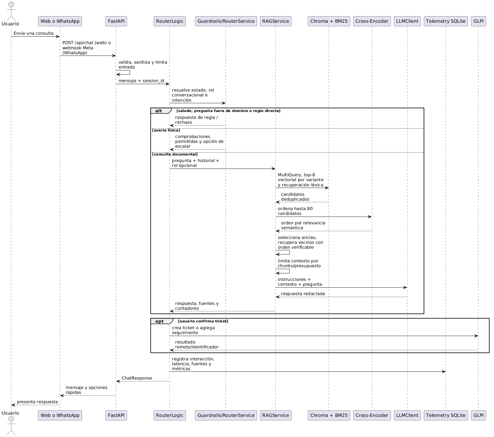

# Flujo de procesamiento de UniMon

Este documento describe el código actual del repositorio a 6 de octubre de 2026. Para instalar el proyecto, ver el [manual técnico](MANUAL_TECNICO_INTEGRAL.md) y la [guía para el próximo practicante](REPLICAR_Y_OPERAR_UNIMON.md).

## Recorrido de una pregunta

## 1. Presentación y API

- La raíz GET / sirve app/static/index.html.
- El navegador conserva un session_id en sessionStorage por pestaña y el botón Nueva conversación crea otro.
- POST /api/chat acepta mensaje o message y session_id. Se rechaza texto vacío; se limita a 600 caracteres y se eliminan etiquetas HTML.
- Se evalúa posible prompt injection antes de neutralizar la cadena, para no perder la señal de seguridad.
- slowapi aplica el límite configurado por defecto de 30 requests/minuto. El comportamiento por proxy depende de la configuración de red/Uvicorn.
- WhatsApp entra por GET /api/whatsapp para handshake y POST /api/whatsapp para eventos; el router delega el trabajo en segundo plano a WhatsAppService.

## 2. Router conversacional y reglas

RouterLogic mantiene el estado y el historial en memoria por session_id. Reglas directas pueden responder sin invocar RAG. El modelo de intención distingue autoservicio de fallas que necesitan soporte físico; las preguntas ajenas al dominio o que piden decisiones académicas reciben una limitación.

El rol puede inferirse o conservarse para reglas/personalización, pero no se usa para excluir por audiencia los documentos del índice. RAG puede aplicar filtros de categoría temática para algunas consultas de finanzas, asuntos académicos, identidad o hardware. Metadato audience no es un filtro de roles.

Los mensajes de estado pueden solicitar retroalimentación, solicitar nombre/correo/descripción para un ticket, preguntar si se quiere agregar seguimiento, cancelar o informar ticket creado. El estado de sesión no sobrevive a reinicio de proceso. El limpiador TTL corre cada cinco minutos y expira sesiones con más de veinte minutos de inactividad.

## 3. Recuperación y generación RAG

### Recuperación

1. Normaliza la pregunta, genera hasta tres variantes MultiQuery en español y conserva también la pregunta original (hasta cuatro consultas), preservando acción/plataforma.
2. Consulta embeddings E5 en Chroma, hasta ocho resultados por variante, con prefijo query: y metadatos temáticos si aplican.
3. Agrega candidatos por recuperación léxica BM25, combina y deduplica.
4. Reordena hasta ochenta candidatos con Cross-Encoder. El score sirve para ordenar; no equivale a probabilidad calibrada de acierto ni hay un cutoff general validado.
5. Selectores y coincidencia entre intención/pregunta/título ayudan a preservar documentos candidatos pertinentes.
6. Si se puede verificar el ID determinista y los metadatos, trae secuencia cercana del mismo archivo en páginas adyacentes. Marca anclas y ordena por fuente/página/chunk.
7. El ensamblado conserva el orden de anclas y vecinos sin descartar chunks por una estimación de tokens. Mantiene topes de cantidad: procedimientos/contexto extendido, hasta 16 anclas y 24 chunks finales; consultas directas, hasta 4 anclas y 8 chunks finales. Los mapas visuales verificados se priorizan para preguntas de ubicación y navegación. El consumo en tokens varía con la longitud real de los fragmentos.

### Ingesta

El pipeline principal procesa PDF y PPTX, extrae contenido por página/diapositiva, tablas e imágenes, limpia boilerplate, segmenta con 800 caracteres y overlap de 150 y persiste embeddings/chunks con metadatos. La interpretación visual requiere Ollama con un modelo de visión; si falta, continúa texto solamente. DOCX y XLSX que estén en data/docs no se indexan por este ingestor principal.

Un chunk es una unidad textual con embedding. Overlap repite 150 caracteres entre fragmentos contiguos para preservar contexto al cruzar un corte. Puede aumentar duplicados y almacenamiento; la deduplicación no se activa automáticamente por el mero hecho de tener overlap.

## 4. Respuesta y fuentes

LLMClient utiliza el proveedor indicado por LLM_PROVIDER. El flujo conversacional puede caer a Ollama local cuando Gemini/OpenAI no están configurados o fallan. Por eso revisa proveedor y modelo efectivos; no basta leer .env.example. Las instrucciones de RAG piden resolver con empatía, contestar partes explícitas y no inventar rutas, permisos, contraseñas ni plazos.

Respuesta incluye tipo/mensaje, estado, opciones rápidas, fuentes y contadores cuando aplica. El nombre de una fuente dice qué fragmentos se usaron, pero no garantiza la calidad. Revisa el contenido exacto y verifica la acción solicitada.

Golden Cache puede encontrar una pregunta similar y añadir la formulación a la búsqueda. En la composición factual actual se ignora la respuesta almacenada. El “Sí” del usuario puede guardar una interacción si los validadores locales la permiten, pero no constituye por sí mismo verificación independiente.

## 5. Tickets e integraciones

GLPI se invoca solo en flujo de solicitud explícita/escalamiento. GLPIService autentica con app/user token, crea el ticket, asocia solicitante y cierra sesión remota; puede consultar y añadir seguimiento según flujo. Verifica respuesta real del servidor y número de ticket.

WhatsAppService valida handshake, deduplica eventos por message_id durante diez minutos en memoria, convierte Markdown y llama Graph API. La firma HMAC se comprueba si se configura el app secret y viene la cabecera correspondiente; configura secret y despliegue antes de exponerse. El trabajo del webhook corre como BackgroundTask dentro del proceso, no como cola durable.

## 6. Persistencia y límites de escala

| Estado/dato | Persistencia | Efecto |
|---|---|---|
| Chunks RAG | Chroma en CHROMA_DB_DIR | Persisten entre reinicios; se reconstruyen desde documentos compatibles. |
| Golden Cache | Chroma en GOLDEN_CACHE_DB_DIR | Separado del corpus. |
| Métricas | SQLite en data/analytics.db | Persiste registros analíticos, no memoria de diálogo. |
| Sesión/historial | Diccionarios de Python | Se pierde al reiniciar; no compartido por múltiples workers. |
| Dedupe de WhatsApp | Diccionario Python con TTL | Un reinicio permite procesar de nuevo un webhook repetido. |
| Visión | data/.vision_cache.json | Evita repetir descripciones para imágenes con hash conocido. |

Para escalar horizontalmente se necesita mover sesiones e idempotencia a un almacén compartido, procesar webhooks en una cola durable, revisar bloqueos SQLite/Chroma, distribuir modelos y medir proveedor/cuotas/latencia. El resultado de 50 consultas concurrentes en desarrollo no es garantía productiva.

## 7. Calidad observada

Última prueba registrada: 50 sesiones simultáneas, 50 respuestas HTTP, 0 errores 429/5xx, fuente esperada 49/49 verificables, p50 65,1 s, p95 70,7 s, máximo 85,9 s. Evaluación estricta 25 correctas de 50 (50%). Consultar el reporte con forma de carga y resultados antes de hacer comparaciones. Esto confirma disponibilidad de esa corrida, no precisión objetivo ni SLA.

